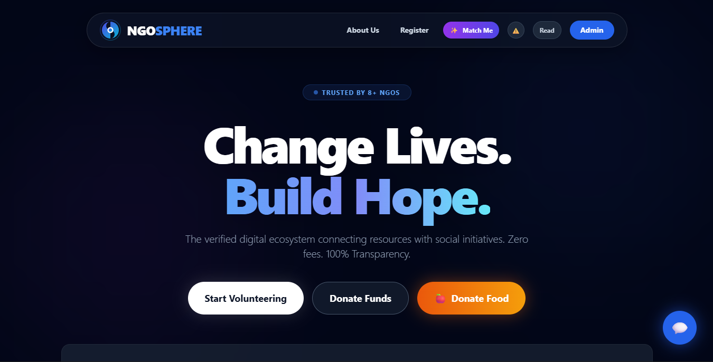
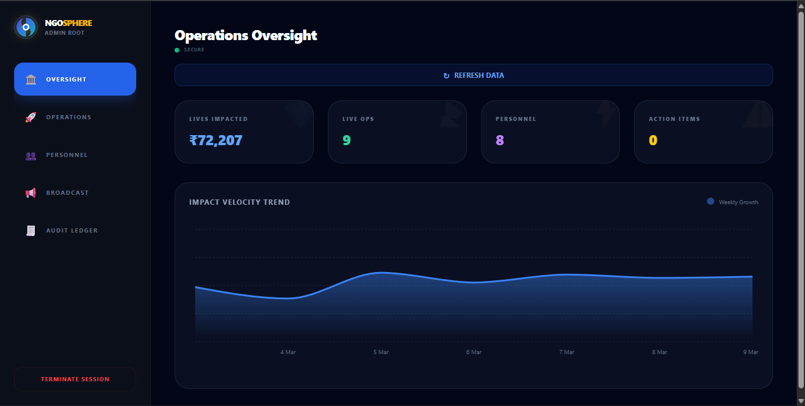
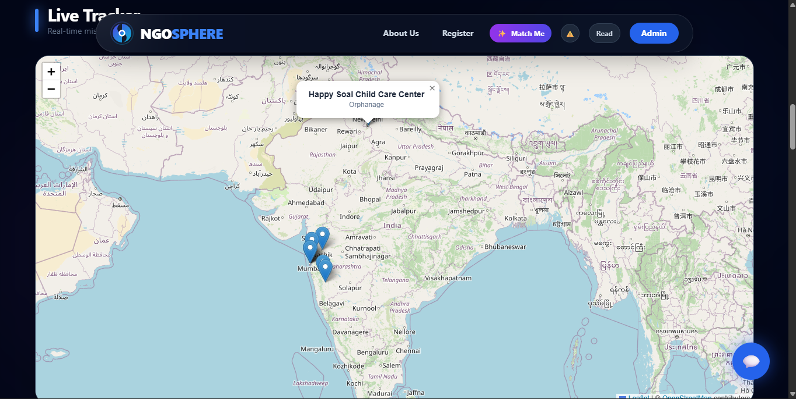
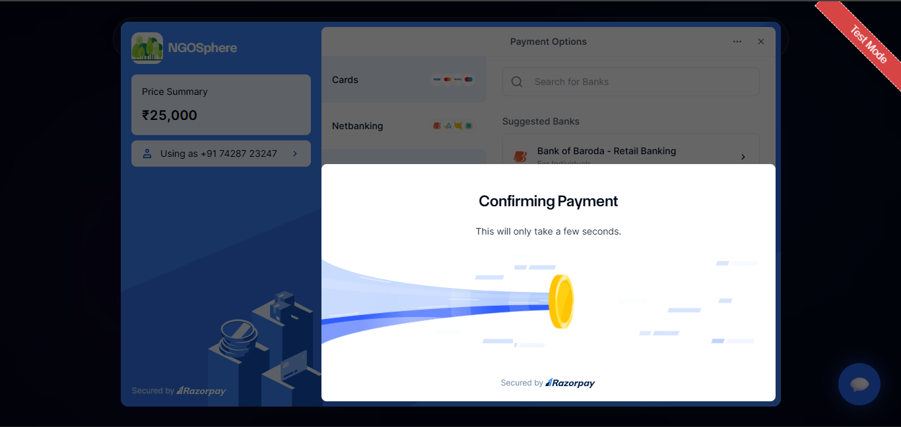
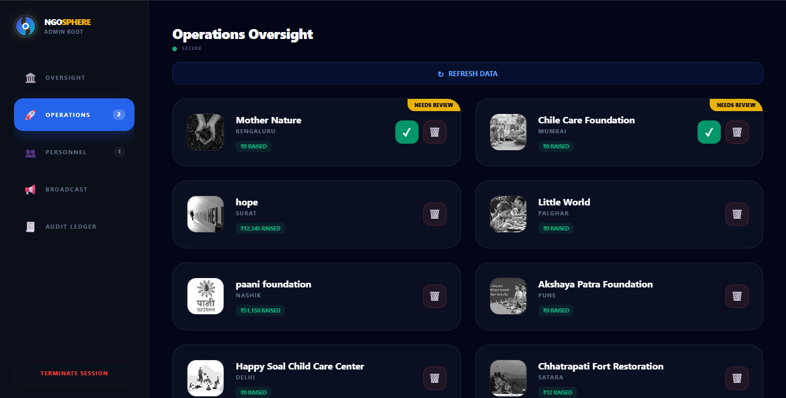

# NGOSphere - NGO Operations Platform

A full-stack web application connecting NGOs with donors and volunteers. Built with the MERN stack, featuring real-time donation tracking, geospatial mapping, and secure payment processing.

**🔗 [Live Demo](https://ngosphere.onrender.com)** | **📊 [Admin Dashboard](https://ngosphere.onrender.com/admin)**

---

## Overview

NGOSphere streamlines NGO operations by centralizing volunteer management, donation processing, and resource tracking in a single platform. The application provides role-based access for admins, verified NGOs, and donors.

### Key Features

- **Role-Based Access Control**: Separate interfaces for admins, NGOs, and donors
- **Donation Tracking**: Real-time transaction logging with CSV export for auditing
- **Geospatial Mapping**: Interactive map showing NGO locations using Leaflet.js
- **Payment Integration**: Razorpay gateway for secure donation processing
- **Volunteer Management**: Admin dashboard for approving and managing volunteers
- **Email Notifications**: Automated emails for volunteer approvals and urgent alerts

---

## Tech Stack

**Frontend**
- React 19 with Vite
- Tailwind CSS for styling
- Recharts for data visualization
- Leaflet.js for interactive maps

**Backend**
- Node.js & Express.js REST API
- MongoDB with Mongoose ODM
- JWT authentication with bcrypt password hashing
- Nodemailer for email automation

**Infrastructure**
- Deployment: Monolithic architecture hosted on Render (Express serving React build)
- Database: MongoDB Atlas

---

## Architecture
```
┌─────────────┐      ┌─────────────┐      ┌─────────────┐
│   React     │◄────►│  Express    │◄────►│  MongoDB    │
│  Frontend   │      │   API       │      │   Atlas     │
└─────────────┘      └─────────────┘      └─────────────┘
       │                    │
       │                    ▼
       │             ┌─────────────┐
       └────────────►│  Razorpay   │
                     │   Gateway   │
                     └─────────────┘
```

---

## Getting Started

### Prerequisites
- Node.js 18+
- MongoDB (local or Atlas)
- Razorpay account (for payments)

### Installation

**1. Clone and Install**
```bash
git clone https://github.com/Jayesh-Patill/ngosphere
cd ngosphere
```

**2. Backend Setup**
```bash
cd backend
npm install
```

Create `.env` file:
```env
PORT=5000
MONGO_URI=your_mongodb_uri
JWT_SECRET=your_jwt_secret
RAZORPAY_KEY_ID=your_razorpay_key
RAZORPAY_KEY_SECRET=your_razorpay_secret
EMAIL_USER=your_email
EMAIL_PASS=your_email_password
DEMO_ADMIN_ENABLED=false
```

For an explicitly enabled public demo, set `DEMO_ADMIN_ENABLED=true` and configure a strong `JWT_SECRET` on the backend. The demo login endpoint is disabled otherwise, issues a short-lived read-only demo token, and returns synthetic records only. Never put demo credentials or secrets in `VITE_` frontend variables.

Start server:
```bash
npm run dev
```

**3. Frontend Setup**
```bash
cd ../frontend
npm install
npm run dev
```

Application runs at `http://localhost:5173`

---

## API Documentation

### Authentication
- `POST /api/auth/register` - User registration
- `POST /api/auth/login` - User login (returns JWT)

### Volunteers (Protected Routes)
- `GET /api/volunteers` - List all volunteers
- `PATCH /api/volunteers/approve/:id` - Approve volunteer (admin only)
- `DELETE /api/volunteers/:id` - Delete volunteer (admin only)

### NGOs (Protected Routes)
- `GET /api/admin/ngos` - List all NGOs
- `PATCH /api/admin/approve/:id` - Approve NGO (admin only)
- `DELETE /api/admin/delete/:id` - Delete NGO (admin only)

### Donations
- `POST /api/transactions` - Log donation transaction
- `GET /api/transactions` - Retrieve transaction history

### Notifications
- `POST /api/send-email` - Send bulk email to volunteers (admin only)

---

## Security

- Password hashing with bcrypt
- JWT-based authentication
- HTTP-only cookies for session management
- Protected API routes with middleware
- Input validation and sanitization
- Razorpay webhook verification for payments

---

## Screenshots

## 📸 Production Preview

### 🏠 User Experience
The NGOSphere landing page features real-time impact statistics synced directly from MongoDB Atlas.


### 🛠️ Core Functionalities
| Admin Control Center | Geospatial NGO Map |
|:---:|:---:|
|  |  |
| *Role-based access for NGO verification* | *Interactive Leaflet.js mapping* |

### 💳 Financial Integrity
| Secure Payments | Transaction Audit | 
|:---:|:---:|
|  |  |
| *Live Razorpay gateway integration* | *Automated transaction logging* |

---

## Future Enhancements

- [ ] Unit and integration tests
- [ ] Analytics dashboard for NGOs
- [ ] Multi-language support
- [ ] Mobile app (React Native)
- [ ] Advanced reporting and export features

---

## License

MIT License

---

## Contact

For questions or collaboration: jaibuildscode@gmail.com